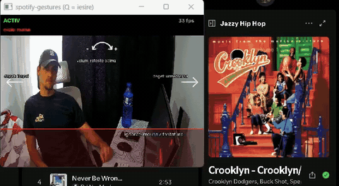

<div align="center">

# ✋ gestures-spotify

**Control Spotify with your hands, from any webcam.**
Real-time hand-gesture recognition with MediaPipe: held signs and a hand turned like a volume knob.




<sub>▶ <a href="docs/demo.mp4">Full demo video (70 s)</a></sub>

</div>

## Gestures

| Gesture | Action |
|---|---|
| ✊ Fist, held still 1.2 s | Pause |
| ✋ Open palm facing the camera, held still 1.2 s | Play |
| 👉 Index finger pointing right, held 1 s | Next track |
| 👈 Index finger pointing left, held 1 s | Previous track |
| ✋↻ Open hand turned clockwise, like a knob | Volume up (5% per 15°) |
| ✋↺ Open hand turned the other way | Volume down |

Everything runs locally: no account, no API key, no image ever leaves the computer.

## How it works

```
webcam ──▶ camera.py ──▶ hand.py ──────────────▶ gestures.py ──▶ detectors.py ──▶ "next", "volume_up", …
           real fps,      21 landmarks +          pose of the     held signs,
           dark/covered   classifier, fingers,    hand            volume knob,
           detection      pointing, angle, palm                   cooldown
```

- **Hand** – MediaPipe finds 21 points on the hand and classifies open palm / fist. Signs it does not know
  (a finger pointing sideways, a hand turned like a knob, how much the palm faces the camera) are computed from
  the geometry of those points.
- **Held signs** – a sign fires once it has been held still for its time; a moving hand restarts the hold,
  a single misread frame does not.
- **Volume knob** – a ratchet: only turning *away* from the starting angle changes the volume, so bringing the
  hand back never undoes it.
- **Safety** – the bottom of the image (mouse and keyboard) is blacked out before the model looks, and after
  every action nothing fires for 1 s.

## Quick start

```powershell
git clone https://github.com/radasanuflorin/gestures-spotify
cd gestures-spotify
python -m venv .venv
.\.venv\Scripts\python.exe -m pip install -r requirements.txt

.\.venv\Scripts\python.exe -m handgestures.preview     # live hand analysis on your webcam
.\.venv\Scripts\python.exe -m handgestures.calibrate   # 90 s guided test + suggested settings
```

The hand model (~8 MB) is downloaded to `models/` on the first run. All thresholds live in
[`config.toml`](config.toml).

```powershell
.\.venv\Scripts\python.exe -m pip install -r requirements-dev.txt
.\.venv\Scripts\python.exe -m pytest                  # 102 tests on simulated hands, no camera needed
```

## Project structure

```
handgestures/
├── camera.py      webcam capture, real frame rate, dark / covered image detection
├── hand.py        MediaPipe landmarks + classifier → fingers, pointing, angle, palm facing
├── gestures.py    pose of a hand, held signs (PoseHold), volume knob (VolumeKnob)
├── detectors.py   all detectors together: ignored zone, hand switches, cooldown
├── view.py        draws the analysis: landmarks, guides, status, progress bar
├── config.py      settings with defaults and validation
├── preview.py     live preview
└── calibrate.py   guided test with a report
tests/             102 tests on simulated hands
```

> **What's not here:** the Spotify side of the app (media-session control, Spotify-only volume, window
> detection, tray icon, startup with Windows) stays in a private repository. This repo is the complete
> gesture-recognition engine.

## Challenges and how I solved them

| Problem | Solution |
|---|---|
| **Dim light halved the frame rate** (30 → 10 fps) and Media Foundation hid it by repeating frames. | Repeated frames are detected and skipped; the preview shows the real fps and warns when the image is dark or the camera is covered. |
| **Reaching for the mouse looked like a gesture** (a hand closing on it is a fist). | The bottom of the image is blacked out *before* the model runs, so a hand there is never found. |
| **Two hands in view**: the tracker jumped between them and the jump looked like a movement. | A large jump together with a change of handedness resets the gesture under way. |
| **The classifier knows only palm and fist.** | Pointing, the knob angle and how much the palm faces the camera come from the geometry of the 21 landmarks. |
| **Swipes were missed at 10 fps** and fired by accident. | Gestures were redesigned several times: held signs and a knob proved reliable at any frame rate. |
| **The volume went back down** when the hand returned. | The knob became a ratchet: only turning away from the start counts. |
| **Holds depended on the frame rate** (counted in frames). | All holds are timed in seconds from when the sign really appeared, with a 1 s pause after each action. |
| **Media Foundation took 30 s to open the camera.** | Its hardware transforms are disabled before OpenCV is first imported. |

## License

[MIT](LICENSE) © Radasanu Florin
